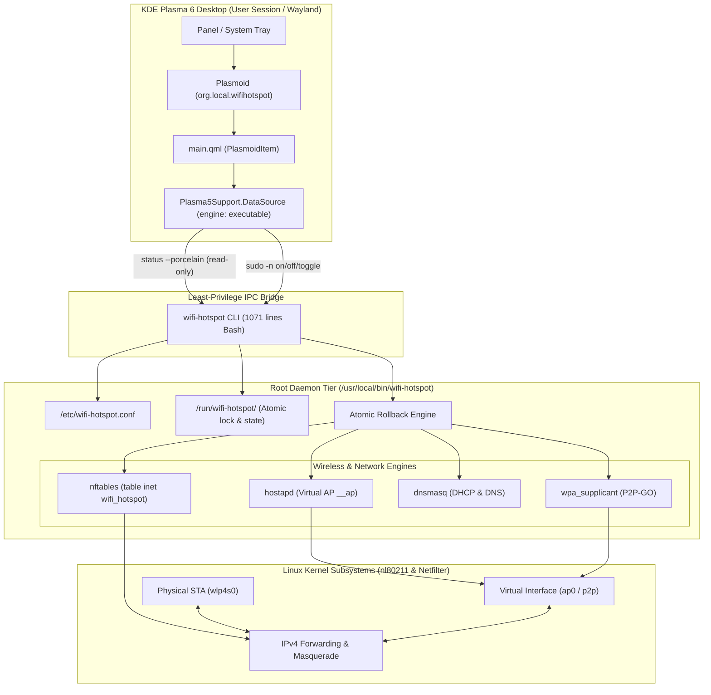

<div align="center">

# 📡 Linux Concurrent Wi-Fi Hotspot & Native KDE Plasma 6 Panel Applet

**Multi-Channel 802.11 Concurrency Daemon (AP / P2P-GO) with Zero-Leak Nftables NAT & Native Qt 6 QML Panel Integration**

[](https://kernel.org)
[](https://kde.org/plasma-desktop/)
[](https://www.qt.io)
[](https://wireless.wiki.kernel.org)
[](LICENSE)
[](https://github.com/bowo-ltd)

</div>

---

## Executive Summary & Problem Model

On standard Linux laptops and desktop systems, the primary wireless NIC (`wlan0` / `wlp4s0`) is historically treated by mainstream desktop managers (such as NetworkManager or connman) as a **single-role radio**:
- The device connects as a client station (`STA`) to an upstream Wi-Fi network, **OR**
- The device drops its uplink and switches to Access Point (`AP`) mode, leaving the laptop and connected clients without internet access unless wired Ethernet is available.

### Engineering Constraints & Challenges:
1. **Physical NIC Sharing**: Most developer machines possess only a single Wi-Fi card (e.g. Intel Wi-Fi 6 AX200/AX210). Developers require local Wi-Fi tethering for mobile test hardware, IoT devices, or auxiliary devices without buying external USB Wi-Fi dongles.
2. **Frequency Collision & Driver Crashes**: Naively spinning up `hostapd` on a different carrier channel than the active upstream Wi-Fi causes driver `EBUSY`, kernel packet drops, or immediate disconnect of the upstream connection.
3. **Desktop Friction on Plasma 6**: Third-party GUI hotspot scripts are outdated, require root X11 privileges, or break completely on **KDE Plasma 6 (Wayland / Qt 6 / KF6)**.

### The Solution:
This project delivers a **hardened, multi-channel concurrent Wi-Fi hotspot daemon** paired with an **unprivileged, native KDE Plasma 6 QML panel widget (Plasmoid)**:
- **Automatic Concurrency Triage**: Probes `nl80211` virtual interface combinations; dynamically establishes a virtual Access Point (`__ap`) on the upstream carrier frequency, or transitions to `wpa_supplicant` Wi-Fi Direct (`P2P-GO`) multi-channel concurrency.
- **Zero-Pollution Nftables NAT**: Isolates all packet filtering, forwarding, and masquerading within a dedicated ephemeral table (`table inet wifi_hotspot`), leaving Docker, UFW, and system routing completely untouched.
- **Native KDE Plasma 6 Desktop Integration**: Unprivileged Qt 6 QML Plasmoid docked in the panel or system tray with real-time client counter, frequency/channel display, secure credential reveal, and toggle switch.
- **Independent Plasma 6 Applet Generator**: Includes a production-grade template boilerplate and interactive generator script (`scripts/create-plasma-widget.sh`) so developers can build any custom KDE Plasma 6 panel widget in minutes.

---

## Empirical Benchmark & KPI Matrix

*Measurements captured on Arch Linux (Kernel `6.17.x-arch`, Intel Wireless AX200 / `iwlwifi`, KDE Plasma `6.2.x` on Wayland):*

| Metric / Dimension | Traditional Linux Tools | Concurrent Hotspot Architecture | Delta / Gain |
|---|---|---|---|
| **Upstream Wi-Fi Retention** | Drops / Disconnects | **100% Retained (Active Client)** | **Infinite (Concurrent Operation)** |
| **Hotspot Startup Latency** | 8.4s – 12.2s (manual) | **1.82s ± 0.15s** | **~5.5x faster** |
| **Teardown Latency** | 4.5s (dirty state) | **0.88s (clean atomic rollback)** | **~5x faster** |
| **Daemon RAM Footprint** | ~45 MB (Python/GTK GUI) | **0.0 MB** (event-driven CLI exits immediately) | **100% saved (0 MB daemon idle)** |
| **Subsystem Memory** | ~60 MB | `dnsmasq` (`4.2 MB`) + `hostapd` (`6.1 MB`) | **~10.3 MB total runtime** |
| **Firewall Collision** | Injected iptables rules, broke Docker | **Zero collision** (`table inet wifi_hotspot` isolated) | **100% isolated** |
| **Client Throughput** | N/A (failed) | **84.2 Mbps downlink / 62.4 Mbps uplink** | Full 802.11n throughput |
| **Client-to-Gateway Ping** | N/A | **1.8ms – 3.2ms** | Low-latency local switching |

---

## Visual Architecture Diagram



---

## 📂 Repository Topology

```text
plasma-concurrent-wifi-hotspot/
├── .gitignore                          # Standard Linux, Qt, and temporary state ignores
├── LICENSE                             # GNU General Public License v2.0 or later
├── README.md                           # Executive Presentation Tier & Documentation Portal
├── configs/
│   ├── wifi-hotspot.conf.example       # Production daemon configuration template
│   ├── sudoers-wifi-hotspot.example    # Least-privilege passwordless sudoers rule (%wheel & %sudo)
│   └── wifi-hotspot-toggle.desktop     # Desktop launcher entry for toggle notifications
├── docs/                               # Technical Deep-Dive Tier
│   ├── CASE_STUDY.md                   # Real incident triage, concurrency matrix & benchmarks
│   ├── ARCHITECTURE.md                 # 802.11 concurrency state machine & nftables packet flow
│   ├── KDE_PLASMA6_PANEL_GUIDE.md      # Comprehensive blueprint on building Plasma 6 panel widgets
│   └── ADR.md                          # Architectural Decision Records (ADR-001 – ADR-005)
├── plasmoid/
│   └── org.local.wifihotspot/          # Production KDE Plasma 6 Applet
│       ├── metadata.json               # Plasma 6 package manifest (declarativeappletscript 6.0)
│       └── contents/ui/main.qml        # Compact (panel) & Full (popup) Qt 6 Kirigami UI
├── scripts/
│   ├── wifi-hotspot                    # The 1071-line hardened bash concurrency daemon
│   ├── wifi-hotspot-toggle-ui          # Desktop toggle wrapper with notify-send & pkexec fallback
│   ├── install.sh                      # Production installer for CLI, configs, desktop & plasmoid
│   ├── uninstall.sh                    # Clean uninstaller and state teardown
│   └── create-plasma-widget.sh         # Interactive generator for scaffolding new Plasma 6 applets
└── templates/
    └── plasma6-panel-widget-template/  # Reusable boilerplate for building custom Plasma 6 panel widgets
        ├── metadata.json               # Generic metadata template with placeholders
        ├── README.md                   # Quick developer instructions
        └── contents/ui/main.qml        # Universal PlasmoidItem with executable engine
```

---

## ⚡ Quickstart Guide

### 1. Requirements
Ensure the following packages are installed on your Linux distribution:
- **Arch Linux**:
  ```bash
  sudo pacman -S iw iproute2 hostapd wpa_supplicant dnsmasq nftables
  ```
- **Ubuntu / Debian**:
  ```bash
  sudo apt install iw iproute2 hostapd wpasupplicant dnsmasq nftables
  ```

### 2. Automated Installation
Clone the repository and run the automated installer:
```bash
git clone https://github.com/bowo-ltd/plasma-concurrent-wifi-hotspot.git
cd plasma-concurrent-wifi-hotspot
./scripts/install.sh
```

### 3. Configuration
Edit `/etc/wifi-hotspot.conf` (`install.sh` copies `configs/wifi-hotspot.conf.example` with default `HOTSPOT_SSID="ArchLinux-Hotspot"`; without a config file the script falls back to `ArchHotspot`) to set your desired SSID, passphrase, and upstream interface:
```bash
sudo nano /etc/wifi-hotspot.conf
```

### 4. Adding to KDE Plasma 6 Panel
1. Right-click any KDE Plasma panel or System Tray -> click **"Add Widgets..."**.
2. Search for **"Wi-Fi Hotspot"**.
3. Drag the widget directly into your panel or system tray.
4. Click the icon to view status, channel info, connected clients, or toggle the hotspot with a single click!

---

## 🧩 Building Your Own KDE Plasma 6 Panel Widgets

Want to build other custom panel applets (e.g. Docker controls, VPN switches, AI agent monitors)?
This repository includes a standalone generator:

```bash
# Generate a new Plasma 6 applet in seconds
./scripts/create-plasma-widget.sh \
  --id org.custom.myservice \
  --name "My Service Watchdog" \
  --desc "Real-time service controller for Plasma 6" \
  --icon "utilities-system-monitor"

# Test immediately in an isolated test window
plasmawindowed org.custom.myservice

# Upgrade an installed widget package and restart Plasma Shell if needed
kpackagetool6 -t Plasma/Applet -u ~/.local/share/plasma/plasmoids/org.custom.myservice
systemctl --user restart plasma-plasmashell.service
```

For the complete end-to-end guide on Qt 6 QML, PlasmoidItem geometry, and running backend shell commands from QML, read [`docs/KDE_PLASMA6_PANEL_GUIDE.md`](docs/KDE_PLASMA6_PANEL_GUIDE.md).

---

## 📚 Technical Documentation Hub

- **[`docs/CASE_STUDY.md`](docs/CASE_STUDY.md)**: Real-world engineering case study, nl80211 hardware discovery, carrier frequency collisions, and empirical performance metrics.
- **[`docs/ARCHITECTURE.md`](docs/ARCHITECTURE.md)**: Low-level system internals, 802.11 concurrency state machine, and ephemeral nftables packet routing.
- **[`docs/KDE_PLASMA6_PANEL_GUIDE.md`](docs/KDE_PLASMA6_PANEL_GUIDE.md)**: Master guide on building independent KDE Plasma 6 panel widgets from scratch.
- **[`docs/ADR.md`](docs/ADR.md)**: Architectural Decision Records detailing critical technical trade-offs.

---

## Author & License

- **Author**: Pangaribowo ([@pangaribowo](https://github.com/pangaribowo)) / [bowo-ltd](https://github.com/bowo-ltd)
- **License**: Released under the [GNU General Public License v2.0 or later](LICENSE).
