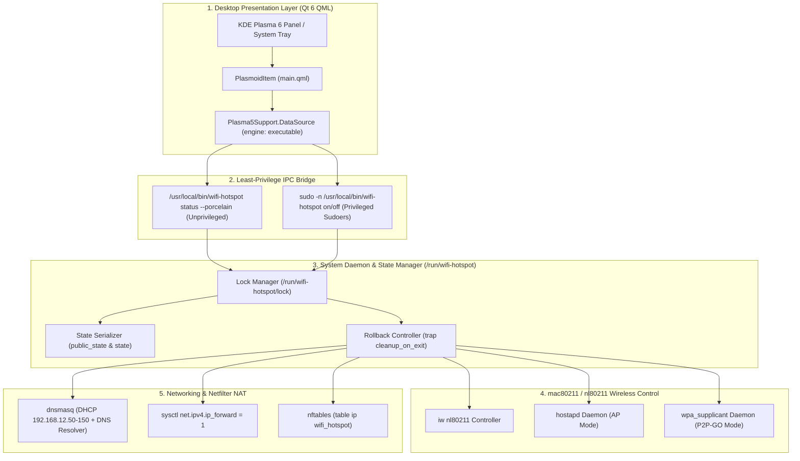
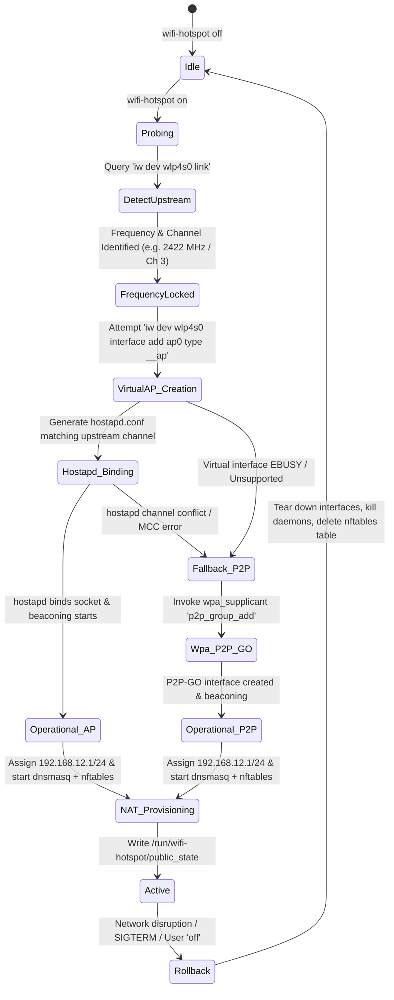

# Low-Level System Architecture & Kernel Internals

## 1. Subsystem Overview

The **Concurrent Wi-Fi Hotspot & KDE Plasma 6 Applet** architecture coordinates multiple Linux kernel subsystems and user-space daemons:



---

## 2. 802.11 Wireless Concurrency State Machine

Linux Wi-Fi drivers implement `mac80211` software stack or full-MAC offload to firmware. When the upstream physical NIC (`wlp4s0`) is connected to an access point (Station mode / `STA`), concurrency states operate as follows:



### Virtual Interface Allocation Mechanics
The virtual Access Point interface (`ap0`) is instantiated directly on top of the underlying physical radio device `phy0`:
```bash
iw dev "$UPSTREAM_IFACE" interface add "$AP_IFACE" type __ap
```
- The special interface type `__ap` instructs the kernel to allocate a secondary network device structure while binding its MAC transmitter pipeline to the physical radio's packet scheduler.
- A unique Locally Administered MAC address (LAA) is derived by flipping the second least significant bit of the first byte of the physical device's MAC address (`02:xx:xx:xx:xx:xx`), preventing MAC address collisions on the local switch fabric.

---

## 3. Ephemeral Nftables Architecture & Packet Flow

To route client packets between the hotspot subnet (`192.168.12.0/24`) and the upstream interface (`wlp4s0`), the daemon establishes a self-contained, isolated Netfilter table:

```
[ Client Device (192.168.12.55) ]
              │
              ▼ (802.11 Frame / Encrypted WPA2-PSK)
[ Virtual AP Interface: ap0 (192.168.12.1) ]
              │
              ▼ (Kernel IP Routing Engine)
┌─────────────────────────────────────────────────────────────┐
│                    nftables Architecture                    │
│                                                             │
│  table ip wifi_hotspot {                                    │
│    chain filter_forward {                                   │
│      type filter hook forward priority filter; policy drop; │
│      ct state established,related accept;                   │
│      iifname "ap0" oifname "wlp4s0" accept;                 │
│    }                                                        │
│                                                             │
│    chain nat_postrouting {                                  │
│      type nat hook postrouting priority srcnat;             │
│      oifname "wlp4s0" ip saddr 192.168.12.0/24 masquerade;  │
│    }                                                        │
│  }                                                          │
└─────────────────────────────────────────────────────────────┘
              │
              ▼ (Source NAT Masquerade)
[ Upstream Physical NIC: wlp4s0 (192.168.1.100) ]
              │
              ▼
[ Upstream Wi-Fi Gateway / WAN Router ]
```

### Safety Invariants:
1. **Zero Collision with Docker / UFW**: Because all rules reside in `table ip wifi_hotspot`, they never conflict with UFW's `ufw-before-input` or Docker's `DOCKER-FORWARD` chains.
2. **Atomic Destruction**: Deleting the table (`nft delete table ip wifi_hotspot`) atomically unregisters the Netfilter hooks at kernel runtime with zero residue.
3. **Restoration of Sysctl**: The daemon backs up the prior state of `net.ipv4.ip_forward` in `/run/wifi-hotspot/prev_ip_forward` and restores it faithfully on teardown.

---

## 4. Least-Privilege IPC Bridge (`--porcelain`)

To ensure complete separation between the unprivileged desktop session (`bakung` / UID 1000) and the privileged daemon (UID 0), the CLI exposes a machine-readable protocol:

```bash
wifi-hotspot status --porcelain
```

### Porcelain Serialization Format:
```ini
HOTSPOT_ACTIVE=1
ACTIVE_MODE=ap
HOTSPOT_IFACE=ap0
HOTSPOT_SSID_ACTIVE=ArchLinux-Hotspot
ACTIVE_CHANNEL=3
ACTIVE_FREQ=2422
HOTSPOT_GW_ACTIVE=192.168.12.1
HOTSPOT_SUBNET_ACTIVE=192.168.12.0/24
UPSTREAM_IFACE=wlp4s0
CONNECTED_CLIENTS=1
```

### Parsing Pipeline in Qt 6 QML:
```javascript
// main.qml: Line-by-line parsing without external parser libraries
var lines = stdout.split("\n");
for (var i = 0; i < lines.length; i++) {
    var line = lines[i].trim();
    if (!line || line.indexOf("=") === -1) continue;
    var parts = line.split("=");
    var key = parts[0].trim();
    var val = parts.slice(1).join("=").trim();
    
    if (key === "HOTSPOT_ACTIVE") root.hotspotActive = (val === "1");
    else if (key === "ACTIVE_MODE") root.activeMode = val;
    else if (key === "CONNECTED_CLIENTS") root.connectedClients = val;
    // ...
}
```

This design provides:
- **Zero Subprocess Overhead**: No Node.js, Python, or external JSON deserializers required.
- **Fail-Safe Robustness**: Parsing is resilient to extra whitespace, comments, or missing keys.
- **Strict Read-Only Guarantee**: Running `wifi-hotspot status --porcelain` requires zero sudo privileges because status queries read `/run/wifi-hotspot/public_state` directly. Sudo is only invoked when initiating state mutations (`on`, `off`, `toggle`, or revealing credentials).
